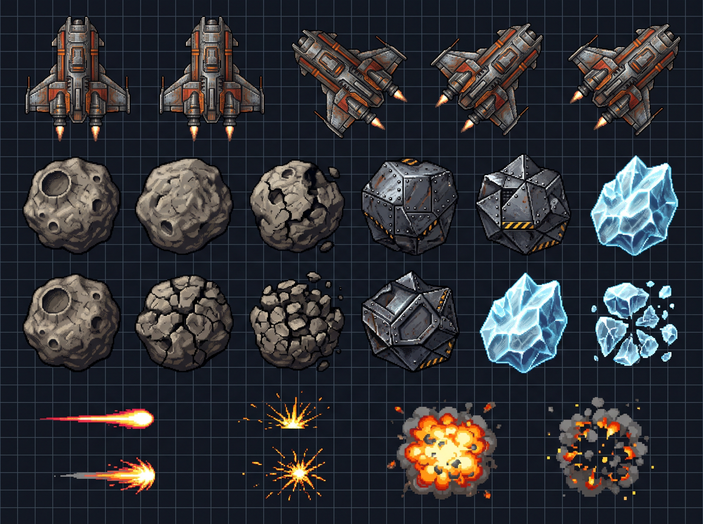

# Space Runner: a decision-model demo

A small browser game for showing a local LLM acting as a decision model. A ship flies up an
asteroid field with 4 lanes, and each tick the pilot picks one of `LEFT`, `RIGHT`, `SHOOT`,
`STAY`. The pilot can be you (keyboard), a classic look-ahead bot, or a model served by
[Ollama](https://ollama.com) on your laptop.

The panels show what the model is doing: the exact state it was sent, its JSON answer and
reasoning, latency, tokens/s, invalid outputs, and how many ticks it was too slow for.



## Prerequisites

- **Ollama**: install the macOS app from <https://ollama.com/download> or run `brew install ollama`.
- **At least one model pulled** (see [Choosing a model](#choosing-a-model)).
- **Python 3** to serve the page (any static file server works). macOS already has it.
- A recent Chrome, Safari, Edge or Firefox.

No build step, no npm, and no CDN dependencies apart from optional web fonts, so it runs offline.

## Running the demo

1. Start Ollama. The desktop app starts the server for you. Without the app, run:

   ```bash
   ollama serve
   ```

2. Pull a model:

   ```bash
   ollama pull qwen3:8b
   ```

3. Serve the game from the repository root:

   ```bash
   python3 -m http.server 8000
   ```

4. Open <http://localhost:8000>.
5. Under **Pilot**, pick **LLM (Ollama)**. The status pill should say `connected`. Pick a model
   and press **Warm up**, so the model is loaded into memory before the audience is watching.
   The first call can take 5 to 30 seconds.
6. Press **Start** (or Enter).

### Why serve it over http://localhost?

The page calls `http://localhost:11434/api/chat` directly from the browser, so Ollama's CORS
rules apply. By default Ollama accepts requests from `localhost` and `127.0.0.1` pages on
any port. A page opened as `file://` sends `Origin: null`, which Ollama rejects.

- Keyboard and bot modes work when you just double-click `index.html`. The LLM mode needs
  the page served from localhost.
- To serve the page from another host, such as a second machine on the network, allow that
  origin in Ollama:

  ```bash
  OLLAMA_ORIGINS="http://my-host:8000" ollama serve
  ```

  For the macOS app, set the variable with
  `launchctl setenv OLLAMA_ORIGINS "http://my-host:8000"`, then restart the app.

## Controls

| Key | Action |
| --- | --- |
| `←` `→` (or `A` `D`) | move one lane |
| `Space` (or `↑`, `W`) | shoot |
| `↓` (or `S`) | stay (useful in turn-based mode) |
| `P` | pause / resume |
| `N` | step exactly one tick (pauses first if needed) |
| `R` | restart |
| `1` `2` `3` | pilot: keyboard / heuristic bot / LLM |

You can switch pilots mid-game, for example to take over from the model.

### Clock modes

These are the main thing the demo shows.

- **Real-time**: the world ticks every *N* ms (use the slider). If the pilot hasn't decided by
  the deadline, the ship does nothing that tick. The request keeps running, and its answer
  is applied on a later tick, so it acts on a state that's already out of date. The log
  marks these as `1 tick late`, and the stats count `ticks w/o decision`. This shows
  latency as part of decision quality.
- **Turn-based**: the world waits for every decision, so only reasoning quality matters. With
  the keyboard pilot, each key press is one turn.
- **Pause + Step**: freeze the world and advance one decision at a time. Each step sends one
  request, so you can talk through the state JSON, the reasoning, and the outcome.

The **seed** sets the asteroid field. The same seed always produces the same asteroids,
whoever is flying, so you can compare models (or a model against the bot) fairly. Finished
games are listed in the **Runs** table.

**Show rows_away** labels every asteroid with the number the model receives, which helps the
audience connect the JSON to the screen.

## How the model is called

Each decision is one stateless call to `POST /api/chat`:

- **system**: the rules of the game (editable in *Ollama → System prompt*, with a reset button).
- **user**: the current observation, for example:

  ```json
  {"turn": 42, "player_lane": 1, "lanes": [
    {"lane": 0, "asteroids": []},
    {"lane": 1, "asteroids": [{"type": "metal", "rows_away": 3}]},
    {"lane": 2, "asteroids": [{"type": "stone", "rows_away": 6, "hits_left": 2}], "lasers_in_flight": 1},
    {"lane": 3, "asteroids": [{"type": "ice", "rows_away": 2, "hits_left": 1}]}]}
  ```

- `format`: a JSON schema (Ollama's structured outputs) that restricts `action` to the four
  legal values, with an optional `reasoning` string first. The answer is therefore always
  parseable. Anything odd is still counted as "invalid output" and treated as `STAY`.
- `think: false` (checkbox) turns off long thinking for reasoning models such as qwen3. If
  the server or model doesn't support the flag, the game retries once without it.
- `keep_alive: 30m` keeps the model loaded between turns.

## Choosing a model

A MacBook Pro M5 with 48 GB can run anything up to about 30B parameters comfortably. Some
starting points (tags as listed on <https://ollama.com/library>; check what's current
before the talk):

| Size | Examples | Notes |
| --- | --- | --- |
| Small (3–4B) | `llama3.2:3b`, `qwen3:4b`, `gemma3:4b` | Fast enough for real-time. Makes visible mistakes, which can be good on stage. |
| Medium (7–14B) | `qwen3:8b`, `gemma3:12b` | A good balance. Usually under a second per decision without reasoning. |
| Large (~30B) | `qwen3:30b-a3b` (MoE, fast for its size), `gemma3:27b` | Better decisions, but too slow for real-time at short ticks. Use turn-based. |

I haven't benchmarked these on an M5, so treat the latency claims as rough. Measure with
the stats panel before the talk.

Expect even good LLMs to lose to the heuristic bot, which is a 50-line brute-force search
that rarely crashes. That can be a talking point in its own right (when to use an LLM as a
decision model, and when plain search is enough), but plan for it.

## A possible talk flow

1. Play a few seconds yourself (keyboard, real-time) to explain the rules.
2. Switch to **Heuristic bot**: a hand-written policy, instant and near-perfect.
3. Switch to **LLM**, **Pause**, and **Step** a few turns. Read the state JSON and the model's
   reasoning aloud.
4. Resume in **Turn-based**: can it survive when time doesn't matter?
5. Switch to **Real-time** at ~350 ms: watch `ticks w/o decision` climb as latency starts to matter.
6. Turn reasoning off: faster but less explainable. Compare scores on the same seed in **Runs**.
7. Optionally edit the system prompt live (e.g. add a strategy hint) and replay the same seed.

## Game rules (exact)

- 4 lanes × 16 rows. The ship sits on row 14, and asteroids fall 1 row per tick.
- Asteroids: **ice** takes 1 hit, **stone** takes 2, **metal** can't be destroyed.
- Lasers travel 4 rows per tick, checked one row at a time, so nothing gets skipped.
- Order of one tick: apply the action → sideways collision → asteroids fall → lasers fly and
  hit → collision in the ship's row → a new asteroid may spawn.
- The field never contains an unavoidable metal wall. The generator checks that a
  dodge-only path survives, and turns the offending asteroid into stone if not.
- Score = ticks survived.

## Project structure

```
index.html              page layout
css/style.css           styles (no framework)
js/game.js              rules: grid world, seeded asteroid field, observation
js/agents.js            heuristic bot, Ollama client, default system prompt
js/render.js            canvas renderer, sprites, effects
js/main.js              tick loop, clock modes, UI
assets/spritesheet.jpeg original sprite sheet
assets/sprites/*.png    sprites cut out of the sheet (transparent)
tools/extract_sprites.py regenerates assets/sprites from the sheet
```

To regenerate the sprites after editing the sheet: `pip install pillow numpy`, then
`python3 tools/extract_sprites.py`. The crop boxes are listed at the top of the script.

## Ideas not implemented (yet)

- **Two models side by side** on the same seed, in split screen.
- **Short memory**: include the last few observations and actions in the prompt, and see
  whether it helps or just adds latency.
- **Observation format experiment**: an ASCII grid instead of JSON. Small models often
  handle one much better than the other.
- **Streaming** the reasoning tokens into the panel, so people watch it think.
- **Post-mortem on crash**: send the last few turns back to the model and ask what went wrong.
- **Export a run** as JSONL (observation, prompt, response, outcome) for later analysis.
